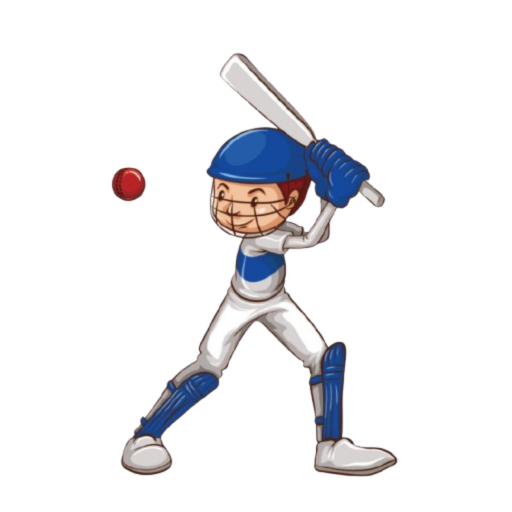
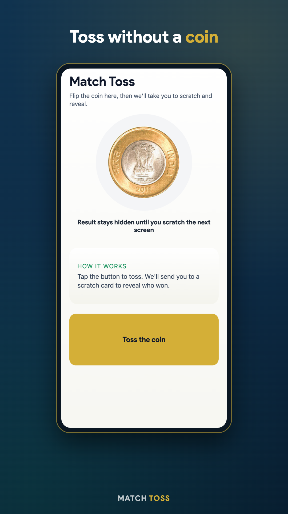
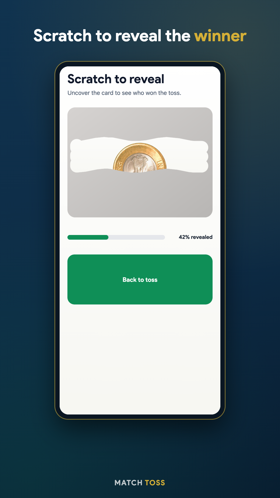
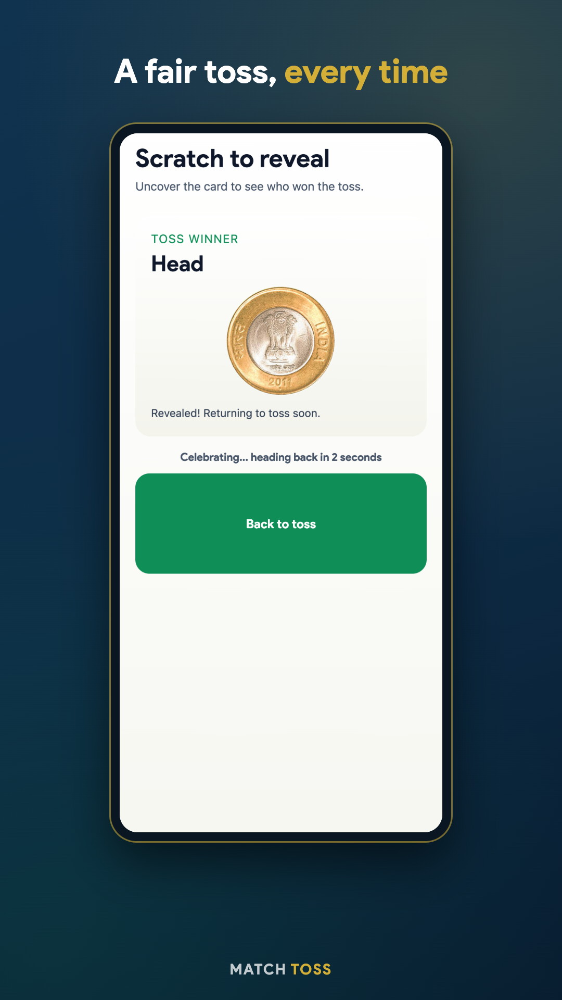

<p align="center">
  
</p>

<h1 align="center">Match Toss</h1>

<p align="center">The cricket toss, without the coin. Flip, scratch &amp; reveal the winner.</p>

## Overview

How often do we get to the field and ask each other if anyone has a coin for the toss? Match Toss lets players and umpires do the toss without a physical coin while keeping the feel of the real thing: an animated coin flip with sound and haptics, followed by a scratch card that hides the result until you rub it away.

Built with [Expo](https://expo.dev) (React Native) and shipped to Android as `com.eatmadi.matchtoss`.

## Features

- Realistic coin flip — rotate animation, coin-flip sound, and haptic feedback
- Result stays hidden until you scratch a digital scratch card on the next screen
- Auto-reveal once 50% of the card is scratched, with a drum-roll celebration
- Real ₹10 coin faces for heads and tails

## Screenshots

| Toss | Scratch | Winner |
|---|---|---|
|  |  |  |

## Development

```bash
npm install
npx expo start        # press a for Android, i for iOS, w for web
npm run lint
```

The app is a two-screen [expo-router](https://docs.expo.dev/router/introduction/) project: `app/index.tsx` (toss) and `app/reveal.tsx` (scratch card). See `TOOLS.md` for more detail on running and releasing.

## Release

Production builds and Play Store submission go through [EAS](https://docs.expo.dev/eas/):

```bash
eas build -p android --profile production
eas submit -p android --latest
```

Play Store listing graphics (icon, feature graphic, phone/tablet screenshots) live in `store-assets/`.

## Feedback

Suggestions or feedback? Find me on [Twitter](https://twitter.com/deepsatflow).

## Credits

1. Coin flip tutorial: https://www.ssaurel.com/blog/learn-to-create-a-flip-coin-application-on-android/
2. Coin flip sound: https://www.partnersinrhyme.com/soundfx/office_sounds/office_coin-flip_wav.shtml
3. App icon / mascot: https://www.clipartmax.com/middle/m2i8G6m2A0A0d3K9_cricket-drawing-sketch-boy-playing-cricket-cartoon/
4. And of course, [StackOverflow](https://stackoverflow.com/) and the Internet
